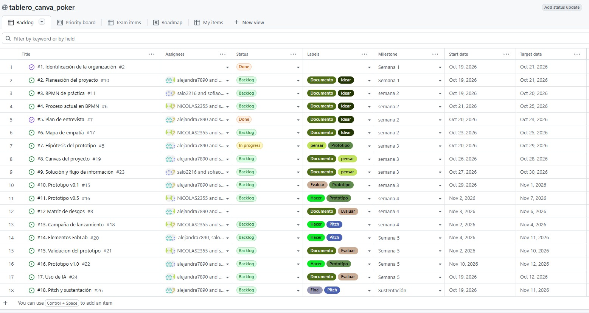
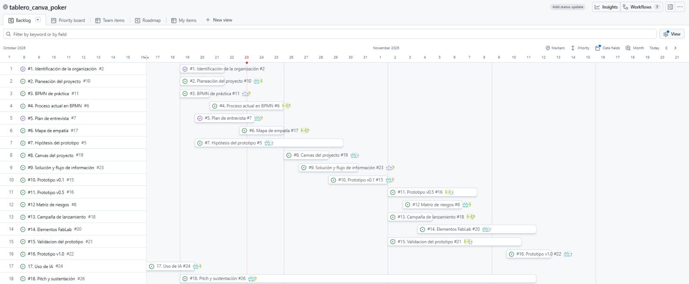

Planeación proyecto  
Roles  
LP – Líder proyecto: alejandra7890  
AP – Analista de procesos: salo2216  
UX – Usuario y campaña: NICOLAS2355  
PR – Prototipo: sofiao  
 
Issues a cargo:  
ROL    | Issues                                                        | Justificación                                                                 |  
Líder  | #1 Identificación de la organización, #2 Planeación del proyecto, #12 Matriz de riesgos, #17 Uso de IA, #18 Pitch y sustentación | Coordina al equipo, define el alcance y el cronograma, anticipa riesgos y lidera la presentación final ante jurados |  
AP     | #3 BPMN de práctica, #4 Proceso actual en BPMN, #8 Canvas del proyecto, #9 Solución y flujo de información | Modela y analiza el proceso actual de la organización y traduce los hallazgos en la propuesta de solución y su flujo de información |  
UX     | #5 Plan de entrevista, #6 Mapa de empatía, #13 Campaña de lanzamiento, #15 Validación del prototipo | Investiga al usuario, identifica sus necesidades y dolores, diseña la campaña y valida la solución con usuarios reales |  
PR     | #7 Hipótesis del prototipo, #10 Prototipo v0.1, #11 Prototipo v0.5, #14 Elementos FabLab, #16 Prototipo v1.0 | Construye y mejora el prototipo por versiones a partir de las hipótesis, la retroalimentación y los recursos del FabLab |  
 
Hitos  
Semana # | Fecha límite | Resultado |  
Semana 1 | 21/10/2026 | Organización identificada y tablero con Gantt |  
Semana 2 | 25/10/2026 | BPMN del proceso actual, entrevista y mapa de empatía |  
Semana 3 | 01/11/2026 | Canvas, solución y prototipo v0.1 |  
Semana 4 | 08/11/2026 | Prototipo v0.5, riesgos y campaña |  
Semana 5 | 12/11/2026 | Validación, FabLab, prototipo v1.0 y pre-sustentación |  
Semana 6 | 13/11/2026 | Exposición ante jurados |  
 
Tablero y cronograma  
  
  
