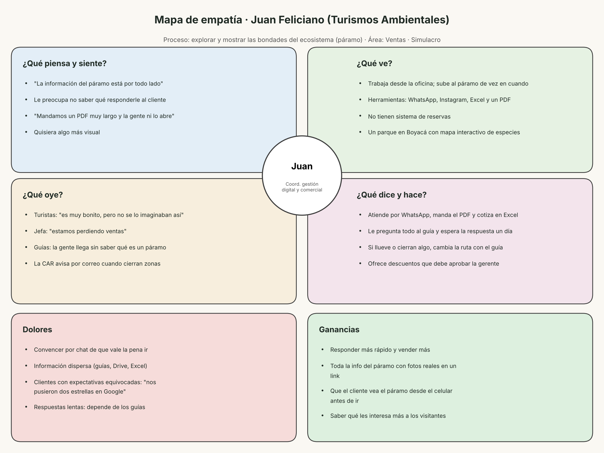

# 04 · Usuario
## 1. Plan de entrevista
**Objetivo:** entender cómo vive el usuario el proceso de [Explorar las bondades del ecosistema] en
[Turismos ambientales] y qué le duele de él.
| Dato | Respuesta |
|---|---|
| Nombre (Juan Feliciano) | |
| Cargo |coordinador de gestion digital y comercial |
| Organización |Turismos ambientales|
| Área |Ventas|
| Fecha y hora |26 de Octubre 1:05 |
| Medio (presencial / llamada / videollamada) |llamada por teams|
| ¿Autorizó publicar sus respuestas en el repositorio? (Sí / No, se usan iniciales)
| |
| Entrevistador(es) |Alejandra Bautista|
> El entrevistado es **Juan Feliciano** de la organizacion, es decir, quien vive el
proceso. No es un cliente de la organización.
## 2. Cómo aplicar la entrevista
**Antes**
1. Reemplacen [proceso], [organización] y [área] por los de su proyecto en todas
las preguntas.
2. Escriban las preguntas 13 y 14 sobre el proceso actual de su organización.
3. Acuerden la cita y definan quién pregunta y quién toma notas.
**Durante (20 a 30 minutos)**
1. Expliquen el objetivo y pidan autorización para publicar las respuestas.
2. Hagan las preguntas en orden y dejen hablar al usuario. No sugieran respuestas
ni presenten su idea de prototipo.
3. Si la respuesta es corta, pregunten "¿por qué?" o "¿me da un ejemplo?".
4. Anoten las frases tal como las dice el usuario.
**Después (el mismo día)**
1. Pasen las notas a `assets/resultados-entrevista.md`.
2. Con esas frases, llenen `assets/mapa-empatia.png`.
## 3. Preguntas
**Piensa y siente**
1. ¿Qué es lo que más le preocupa cuando hace [una exploracion en los recoridos ambientales turisticos?
2. Si pudiera cambiar una sola cosa de como se explora y se presenta el ecosistema a los clientes ¿que cambiaria y por qué?
**Ve**
3. ¿Como son los lugares donde explora el ecosistema y prepara las ofertas para los turistas?¿Con que herramientas trabaja (Mapas, fotos, excel, redes socales, sistema de reservas, material impreso)?
4. ¿Ha visto en otra empresa de turismo o en otro destino una forma de mostrar el ecosistema que le parezca mejor? ¿Cual y que la hace mejor?
**Oye**
5. ¿Qué le dicen los turistas, sus compañeros o su jefe sobre la manera en que turismos ambientales muestra y vende el ecosistema?
6. ¿De quién recibe instrucciones, quejas o recomendaciones sobre las experiencias en el ecosistema (guias, comunidad local, autoridades ambientales, clientes) y por que medio (reuinon, whatsapp,correo,reseñas) ?
**Dice y hace**
7. Cuénteme paso a paso qué hizo la última vez que exploro el ecosistema para preparar una oferta o atender a u grupo de turistas.
8. ¿Qué hace cuando algo sale mal durante la exploracion o la venta (mal clima, zona cerrada, cliente inconforme, informacion que no coincide con lo ofrecido) y a quien acude?
**Dolores**
9. ¿Qué es lo más dificil o frustante de explorar y dar a conocer las bondades del ecosistema a los clientes?
10. ¿Cuenteme de la última vez que tuvo un problema concreto con este proceso: ¿Que paso y como termino?
**Ganancias**
11. Si  el [proceso] de explorar y mostrar el ecosistema funcionara perfectamente, ¿qué cambiaría en su día de trabajo y en sus ventas?
12. ¿Qué  herramienta informacion o apoyole ayudaría a ahorrar tiempo, dinero o esfuerzo al explorar y presentar el ecosistema a los turistas?
**Proceso actual en [organización]** (las escribe el equipo)
13. ¿Como logra que la exploracion y la venta del ecosistema no lo dañen? ¿y que ciudadanos o reglas sigue hoy y cuales les gustarian que existieran?
14. ¿Como imagina que sera este proceso en turismos ambientales dentro de dos años si las cosas mejoran?
## 4. Resultados
- [Resultados de la entrevista](../assets/resultados-entrevista.md)
  1. Pues lo que más me preocupa es que la información del páramo está por todo lado. Unas fotos las tiene un guía, otras están en el Drive, y cuando un cliente me pregunta algo a veces no sé qué decirle.
  2. Cambiaría cómo mostramos el páramo. Mandamos un PDF muy largo y la gente ni lo abre. Me gustaría algo más visual.
  3. Yo trabajo más que todo desde la oficina y subo al páramo de vez en cuando. Uso WhatsApp, Instagram, un Excel y el PDF. No tenemos un sistema de reservas.
  4. Sí, en un parque de Boyacá vi un mapa donde uno toca y le sale la info de cada planta o animal. Me pareció muy chévere, porque la gente llega sabiendo qué va a ver.
  5. Los turistas dicen que es muy bonito, pero que no se lo imaginaban así. Mi jefa dice que estamos perdiendo ventas, y los guías dicen que la gente llega sin saber qué es un páramo.
  6. La gerente me da las instrucciones los lunes. Las quejas llegan por WhatsApp y por las reseñas de Google. Y la CAR nos escribe por correo cuando cierran alguna zona.
  7. La última vez fue con un colegio. Me escribieron por WhatsApp, les mandé el PDF y me preguntaron qué animales iban a ver. Le pregunté al guía, que me contestó al otro día. Hice la cotización en Excel, la mandé y como a la semana confirmaron.
  8. Si llueve o cierran algo, llamo al guía y cambiamos la ruta, y le aviso al cliente por WhatsApp. Si se pone bravo, le ofrezco un descuento, pero eso lo tiene que aprobar la gerente.
  9. Lo más difícil es convencer a la gente por chat de que vale la pena ir. El páramo no es como ir a la playa, toca explicarles por qué es importante.
  10. Hace como dos semanas vino un grupo que quería ver osos de anteojos porque los vieron en una foto de nosotros. No vieron ninguno y nos pusieron dos estrellas en Google.
  11. Respondería más rápido, no tendría que estar preguntándole todo a los guías y creo que vendería más.
  12. Algo donde esté toda la info del páramo con fotos reales, que yo le pueda mandar al cliente en un link.
  13. Seguimos lo que dice la CAR: grupos de máximo 20 personas, no salirse del sendero y nada de mascotas. Me gustaría que antes de subir hubiera una charla cortica para que la gente entienda por qué hay que cuidarlo.
  14. Me imagino que la gente pueda ver el páramo desde el celular antes de venir, y que nosotros sepamos qué es lo que más les interesa para vender mejor.
- 
**Hallazgo principal:** lo que más le duele al usuario es ______________________
porque __
