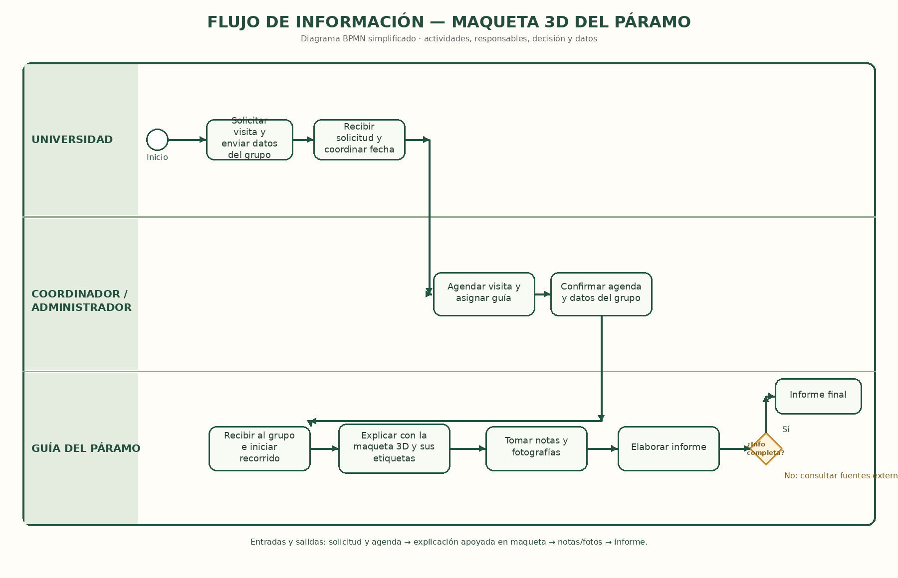

06 · Solución y flujo de información  
 
Solución propuesta 
 
Qué cambia en el proceso con la solución (máximo 5 líneas): 
 
Se incorpora una maqueta impresa en 3D del páramo con etiquetas que nombran y describen sus elementos característicos.  
El guía utiliza la maqueta como apoyo visual y táctil para explicar el ecosistema durante el recorrido.  
La información queda visible y organizada, en lugar de depender únicamente de una explicación verbal y de las notas o fotos del grupo.  
Así se facilita el registro de la práctica y se reduce la necesidad de completar información con fuentes externas. 
 
Flujo de información 
 

 
Paso	Entrada (qué información llega)	Proceso (qué se hace)	Responsable (quién)	Salida (qué información sale)
1	Solicitud de visita y datos del grupo universitario.	Solicitar y coordinar la visita al páramo.	Universidad	Solicitud de visita recibida.
2	Solicitud recibida, fecha de visita y disponibilidad del guía.	Agendar la visita y asignar un guía.	Coordinador / administrador	Visita agendada y guía asignado.
3	Confirmación de la visita y llegada del grupo.	Recibir al grupo e iniciar el recorrido; presentar la maqueta 3D como apoyo.	Guía del páramo	Grupo recibido y maqueta disponible para la explicación.
4	Maqueta 3D con etiquetas descriptivas de los elementos del páramo.	Explicar las características del ecosistema señalando los elementos de la maqueta para que el grupo los observe y toque.	Guía del páramo	Información del ecosistema organizada y accesible para el grupo.
5	Explicación apoyada en la maqueta, notas y fotografías del recorrido.	Registrar la información y elaborar el informe; comprobar si está completa y, si hace falta, consultar fuentes externas.	Universidad	Informe de la práctica con información del ecosistema. 
 
Antes y después 

Proceso actual	Proceso con la solución
El guía explica verbalmente el ecosistema; los estudiantes toman notas y fotos. Si la información queda incompleta, deben buscar en fuentes externas antes de elaborar el informe.	El guía apoya la explicación con una maqueta 3D del páramo y etiquetas con nombres y descripciones. El grupo puede observar y tocar los elementos representados, registrar la información y elaborar el informe con un apoyo visual organizado; si aún faltan datos, se consultan fuentes externas.

